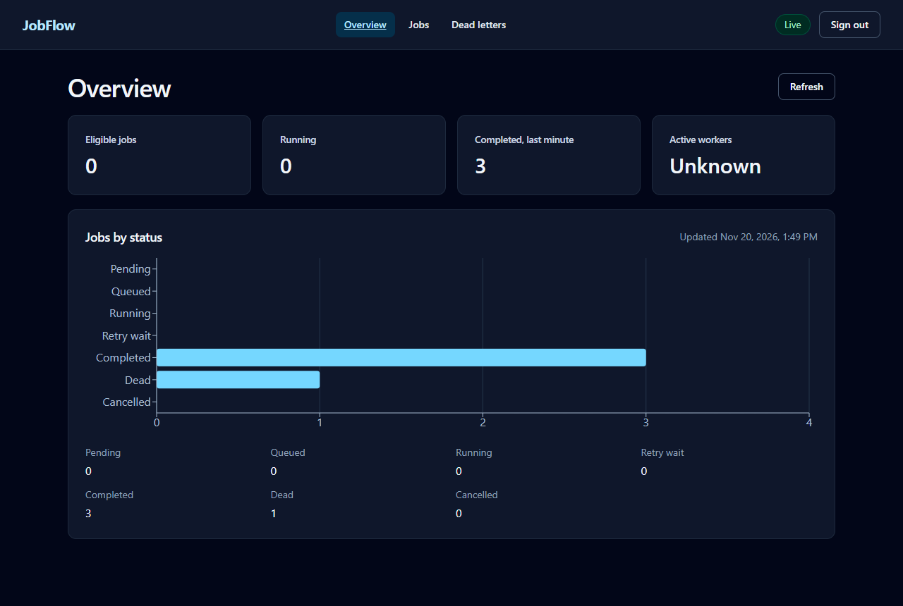

# JobFlow — Job Processing and Observability

JobFlow runs asynchronous jobs and gives tenant administrators an operator console to see what is waiting, which attempts failed, and what recovered. Prometheus and Grafana show how the processing system behaves across the API, dispatcher, workers, and scheduler.



[Watch the 2:22 operator walkthrough](docs/assets/jobflow-demo.webm) · [Explore the Grafana dashboard](docs/assets/jobflow-grafana.png)

## Administrator workflow

1. **Start with Overview.** Check job counts by state and completions in the last minute. Follow the links to jobs waiting for retry or jobs that reached the dead-letter queue.
2. **Investigate a job.** Open its attempt history and event timeline to see when it started, what error category was recorded, and whether another attempt is scheduled. Socket.IO refreshes the dashboard as jobs change. The browser refreshes from the REST API on reconnect.
3. **Replay a dead letter.** Enter a reason to create a new job linked to the original. The original history is preserved, and the API allows one replay per dead letter.
4. **Check Grafana for system-wide symptoms.** Compare queue wait, retries, outbox age, and worker activity to see where a backlog is forming.

### Access

| Surface | Access |
| --- | --- |
| JobFlow Overview, Dead Letters, and replay | The `ADMIN` role is required by the API. Results and actions are scoped to the signed-in tenant. |
| JobFlow Jobs and job history | Authenticated members and admins can access their tenant’s jobs. This README uses the seeded admin account for the operator workflow. |
| Grafana | Separate Grafana credentials. The dashboard shows deployment-wide metrics. |
| Prometheus and scrape endpoints | Infrastructure access. Local Compose binds Prometheus and Grafana to loopback. The production proxy blocks public access to metrics and health routes. |

[API and authentication contract](docs/DATA_AND_API_CONTRACTS.md) · [Production proxy configuration](infra/caddy/Caddyfile.prod)

## Run the observability demo locally

You need Docker with the Compose plugin, Node.js matching the root [package.json](package.json), and npm. On Windows, run Docker Desktop in Linux container mode.

**1. Start the stack.** From the repository root:

```sh
docker compose -f infra/compose.yaml --profile observability up --build --wait
```

Compose applies the Prisma migration before starting the API. PostgreSQL, RabbitMQ, and the browser-facing services use loopback ports for local development. [Compose configuration](infra/compose.yaml)

**2. Create the demo administrator.** Copy `.env.example` to `.env` if you have no local copy. Set `SEED_ADMIN_PASSWORD` in `.env` to a unique password of at least 16 characters, then run:

```sh
npm ci
npm run db:generate
npm run db:seed
```

The seed creates tenant `demo`, admin `operator@example.test`, and three sample jobs. Rerunning it preserves the existing password and reuses the sample jobs. [Seed script](scripts/seed.mjs)

**3. Open the dashboards.**

| Service | Local address | How to use it |
| --- | --- | --- |
| JobFlow | <http://127.0.0.1:5173> | Sign in with tenant `demo`, email `operator@example.test`, and the password you set. Submit a report job and check that it reaches **Completed**. |
| Grafana | <http://127.0.0.1:3010> | Sign in with the disposable local Grafana credentials in [Compose](infra/compose.yaml) and open the provisioned JobFlow dashboard. |
| Prometheus | <http://127.0.0.1:9090/targets> | Check the scrape targets for the API, dispatcher, worker, and scheduler. |

Stop the stack with the following command. Named volumes retain the local data.

```sh
docker compose -f infra/compose.yaml --profile observability down
```

## What the Grafana panels measure

| Signal | What to look for |
| --- | --- |
| Completed jobs per second | The rate of jobs reaching `COMPLETED`. Compare it with job arrivals and backlog during load. |
| Attempt failure and terminal success | Attempt failure uses finished attempts as its denominator. Terminal success uses jobs settled as `COMPLETED` or `DEAD`. A job can have a failed attempt and ultimately complete. |
| p95 queue wait, execution, and end-to-end duration | Queue wait starts when an attempt becomes eligible and ends at claim. Execution runs from claim to committed outcome, with the Grafana panel filtered to successful attempts. End-to-end runs from job acceptance to terminal state. |
| Job states, dead letters, retries, and expired leases | Identify a growing backlog, repeat failures, or interrupted worker attempts. |
| Pending outbox intents and age of the oldest due intent | See whether dispatch work is accumulating before reaching RabbitMQ. |
| Active worker consumers and jobs, process CPU, and resident memory | Compare worker activity with resource use while investigating throughput. |

Application metric labels use bounded values such as job type, status, and outcome. Job IDs, tenant IDs, and email addresses are excluded from metric labels. Structured Pino logs provide request and job context. PostgreSQL holds the durable job and attempt records used to reconcile counters after failures. [Metrics definitions and queries](docs/METRICS_AND_BENCHMARKS.md) · [Provisioned dashboard definition](infra/grafana/dashboards/jobflow.json)

## How jobs move through the system

The Express API commits each accepted job and its publication intent together in PostgreSQL. The dispatcher publishes the intent to RabbitMQ with broker confirms. A worker claims the job with a database lease and acknowledges the message after committing the outcome. The scheduler picks up due retries and expired leases. Delivery is at least once. The demo handlers deduplicate effects in PostgreSQL, and a stale worker cannot finalize a job after its lease changes.

The dashboard uses React, Vite, and Socket.IO. The processing services use Node.js with JavaScript ESM, PostgreSQL with Prisma, and RabbitMQ. Docker Compose runs the stack, and Caddy serves the production frontend and proxies API traffic. [Architecture and failure modes](docs/ARCHITECTURE.md)

## Verify and deploy

```sh
npm run lint
npm run format:check
npm run test:unit
npm run build
npm run test:integration
```

The integration suite uses isolated Docker Compose services. The native monitoring check, `npm run test:observability`, requires disposable database and broker fixtures plus local Prometheus and Grafana installations. Its recorded run reconciled the Prometheus completion counter with PostgreSQL and queried live Grafana series for completion rate and p95 latency. [Observability acceptance evidence](docs/phases/PHASE_06_OBSERVABILITY.md) · [Recorded hosted CI run](https://github.com/Nikhil-X-codes/Job-Observability/actions/runs/44709186444)

The capacity and burst report reconciled **26,475 jobs across 22 comparable native trials**. In five separate controlled worker-crash trials, median recovery was **16.270 seconds**, with one committed effect per recovered job. The reports record the Windows host, workload, timing windows, and overload diagnostics. [Capacity, burst, and crash recovery](benchmarks/results/2026-11-20-native-capacity/REPORT.md) · [Fixed-rate worker comparison](benchmarks/results/2026-11-20-native-mixed/REPORT.md)

AWS deployment remains deferred. The repository includes a production Compose overlay, a manual release workflow, and a single-EC2 deployment runbook with HTTPS, backup, and cleanup steps. [AWS deployment runbook](docs/AWS_DEPLOYMENT.md) · [Phase 08 release status](docs/phases/PHASE_08_AWS_RELEASE.md) · [Project tracker](PROJECT_TRACKER.md)
