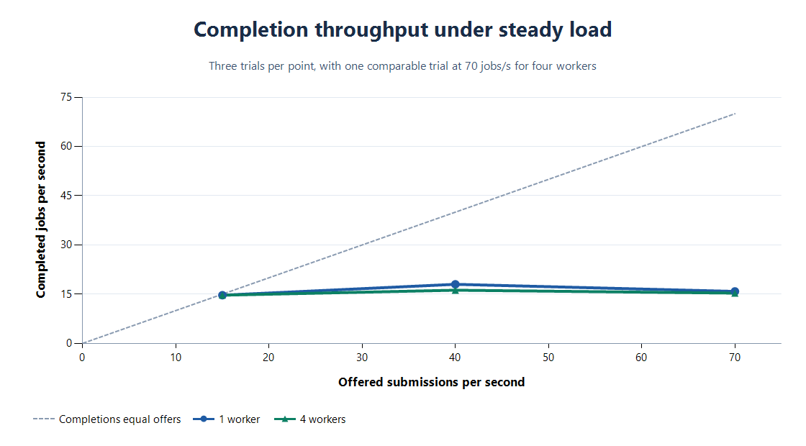
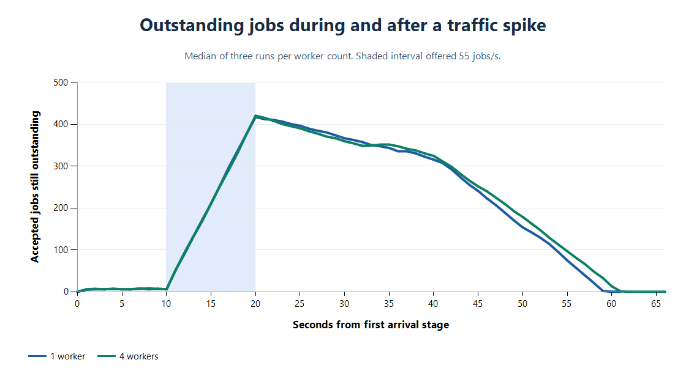

# Native capacity, burst and worker-crash benchmark

The **22 load runs within the comparison tolerance** accepted and completed **26,475 jobs**. PostgreSQL reconciled 11,779 in-window completions and 14,696 completions after the arrival cutoff, with zero remaining jobs, missing effects, duplicate committed effects, or rejected submissions. k6 reported 3 missed iteration starts within those runs. Two overload diagnostics and five worker-crash trials are reported separately.

## Environment and design

- Source commits `cb5817250b00fbafc60cc7d470ccd67c95b8fe9c` and `97a905352bb2a318390251ec14b54e0462c4cb94`. Capacity start `2026-11-20T09:27:58.836Z` UTC. 11th Gen Intel(R) Core(TM) i3-1115G4 @ 3.00GHz, 4 logical CPUs, 7.75 GiB RAM, Windows 10.0.26300 x64.
- Node v26.13.0, PostgreSQL 17.12 with `fsync=on` and `synchronous_commit=on`, RabbitMQ 4.3.8 with a quorum queue, Prometheus 3.16.0, and k6.exe v2.4.0 (commit/dd9395906d, go1.26.11, windows/amd64). API write limit 12,000 per tenant per minute for the isolated fixture. Worker prefetch 10.
- k6 submitted one job per open-loop iteration. It rotated report, fake email, and mock webhook jobs evenly. The clients, API, PostgreSQL, broker, dispatcher, scheduler, workers, and Prometheus ran on the same reserved loopback host. Demo handlers used local delays and the durable effect ledger.
- Capacity sweep used 1 and 4 workers with 15, 40, and 70 offered jobs/s and 35-second measurement windows. Each measured run followed a drained 10-second warmup at 15 jobs/s. The four-worker 70 jobs/s condition has one comparable trial and two diagnostics.
- Burst runs used 1 and 4 workers, three repetitions each. The 40-second profile was 10 jobs/s for 10 seconds, 55 jobs/s for 10 seconds, then 10 jobs/s for 20 seconds. Each measured burst followed the same warmup.
- k6 began with 50 preallocated VUs per stage. The initial phase stopped at the third one-worker 70 jobs/s trial because the generator missed three starts. Its 2,448 submitted jobs all completed. It remains in the comparison with its original exit code and miss count. Subsequent trials allow up to 0.5% missed starts in each measurement window.
- Two four-worker attempts at 70 jobs/s exceeded that tolerance. The second used 100 preallocated VUs as a calibration check. The steady comparison and the bursts use 50 VUs. Each fresh fixture and generator configuration is identified in the data.

## Capacity sweep

| Workers | Offered jobs/s | Comparable trials | Completed jobs/s, median (range) | HTTP submit p95, ms | First claim p95, ms | End-to-end p95, ms | Jobs outstanding at cutoff | Drain, s |
| ------: | -------------: | ----------------: | -------------------------------: | ------------------: | ------------------: | -----------------: | -------------------------: | -------: |
|       1 |             15 |                 3 |              14.69 (14.51–14.74) |                  40 |                 576 |                871 |                         11 |     0.71 |
|       1 |             40 |                 3 |              18.00 (16.80–18.00) |                  42 |               39756 |              39959 |                        770 |    42.02 |
|       1 |             70 |                 3 |              15.83 (15.57–16.17) |                  52 |               97633 |              97906 |                       1896 |   102.36 |
|       4 |             15 |                 3 |              14.69 (14.66–14.74) |                  43 |                 620 |                950 |                         11 |     0.66 |
|       4 |             40 |                 3 |               16.20 (8.14–17.14) |                  47 |               43247 |              43494 |                        833 |    45.73 |
|       4 |             70 |                 1 |                            15.31 |                  88 |              104134 |             104375 |                       1914 |   109.20 |

Completed jobs/s divides unique PostgreSQL completions inside the configured arrival window by its duration. The window starts at the first k6 scenario's recorded start timestamp. Latency columns use the median of available run-level p95s. First claim is database job creation to the first durable claim. End-to-end is database job creation to terminal transition. Outstanding jobs had been admitted before the cutoff and had yet to finish. Drain is cutoff to the latest cohort completion, floored at zero. Per-run p50/p95/p99 and one-second acceptance/completion bins are included in the measurements.

At 40 offered jobs/s, throughput was 18.00 completed jobs/s with one worker and 16.20 with four. At 70 offered jobs/s, the one-worker median was 15.83 jobs/s and the single comparable four-worker trial was 15.31 jobs/s. First-claim latency and outbox lag grew under overload while attempt execution stayed in the hundreds of milliseconds. This points to pre-claim waiting on this setup. Component-level attribution requires separate timing of dispatch, broker confirmation, and database storage.

### Four-worker overload diagnostics at 70 offered jobs/s

| Preallocated VUs | Missed starts | Accepted | Accepted per target-window second | In-window completions | Completed at reconciliation | Still outstanding |
| ---------------: | ------------: | -------: | --------------------------------: | --------------------: | --------------------------: | ----------------: |
|               50 |            56 |     2396 |                             68.46 |                   530 |                        2396 |                 0 |
|              100 |           178 |     2277 |                             65.06 |                   528 |                        2115 |               162 |

These attempts are outside the 0.5% generator miss tolerance and are preserved separately. The 100-VU attempt also exceeded the bounded drain check and its Prometheus export timed out. The outstanding count comes from the final PostgreSQL snapshot. The durable completion figures for this attempt cover only jobs observed before fixture cleanup.

## Burst and drain

| Workers | Peak outstanding jobs | Outstanding jobs at second 20 | Seconds after spike to ≤10 outstanding | End-to-end p95, ms | Outstanding at cutoff | Drain, s |
| ------: | --------------------: | ----------------------------: | -------------------------------------: | -----------------: | --------------------: | -------: |
|       1 |                   420 |                           418 |                                     39 |              26417 |                   316 |    19.16 |
|       4 |                   422 |                           421 |                                     41 |              27732 |                   325 |    21.02 |

Values are medians across repetitions. The peak counts accepted nonterminal jobs at database timestamp resolution. The time to ≤10 is the first one-second sample at or after second 20 with ten or fewer outstanding jobs.

## Process and outbox samples

| Profile | Workers | Offered peak jobs/s | Worker CPU, cores | Worker RSS, MiB | API + dispatcher + scheduler CPU, cores | Oldest due outbox, s |
| ------- | ------: | ------------------: | ----------------: | --------------: | --------------------------------------: | -------------------: |
| Steady  |       1 |                  15 |              0.19 |           173.8 |                                    0.26 |                 0.95 |
| Steady  |       1 |                  40 |              0.20 |           212.3 |                                    0.36 |                42.64 |
| Steady  |       1 |                  70 |              0.19 |           151.0 |                                    0.46 |               104.42 |
| Steady  |       4 |                  15 |              0.33 |           479.7 |                                    0.28 |                 0.89 |
| Steady  |       4 |                  40 |              0.37 |           583.8 |                                    0.36 |                71.59 |
| Steady  |       4 |                  70 |              0.22 |           586.3 |                                    0.37 |               107.51 |
| Burst   |       1 |                  55 |              0.22 |           214.6 |                                    0.55 |                28.14 |
| Burst   |       4 |                  55 |              0.36 |           585.3 |                                    0.53 |                30.87 |

These are the highest observed Prometheus samples across repetitions. CPU uses a 10-second rate. Each summed series includes only timestamps with a sample from every process in the group. The query step and scrape interval were both two seconds. The resource samples cover application processes. PostgreSQL, RabbitMQ, and k6 share the host and have a separate resource footprint.

## Repeated worker-crash recovery

Median kill-to-completion was **16.270 s** (range 16.018–16.638 s, five trials). Each trial ended with one failed lease-expiry attempt, one successful retry, and one committed business effect.

| Trial | Lease remaining at kill, s | Expiry to reap, ms | Reap to replacement claim, ms | Retry execution, ms | Kill to completion, s | Effects |
| ----: | -------------------------: | -----------------: | ----------------------------: | ------------------: | --------------------: | ------: |
|     1 |                     14.586 |                429 |                           823 |                 409 |                16.247 |       1 |
|     2 |                     14.585 |                104 |                          1511 |                 380 |                16.580 |       1 |
|     3 |                     14.619 |                104 |                          1177 |                 370 |                16.270 |       1 |
|     4 |                     14.586 |                308 |                           758 |                 366 |                16.018 |       1 |
|     5 |                     14.592 |                511 |                          1166 |                 369 |                16.638 |       1 |

An ordinary worker received the HTTP-submitted job through RabbitMQ. A temporary PostgreSQL table lock held the worker at the final effect write so the harness could verify the wait and kill the process before its lease expired. The dispatcher and scheduler stayed up. A replacement worker connected before expiry. The observed time includes the production 15-second lease, scheduler polling, retry delay, dispatch, and normal execution. The five deterministic trials describe this fault configuration.

## Reproduction and limits

Run the [native benchmark commands](../../../docs/METRICS_AND_BENCHMARKS.md#capacity-burst-and-crash-profiles) with the versions and configuration above, preferably on the same class of machine with load generation on the same host. These 35-second plateaus and short bursts characterize this deployment and workload. Longer soak tests and real downstream email or webhook destinations can produce different capacity and latency.

The [sanitized measurements](measurements.json) contain all measured load cohorts and all recovery observations. Local raw runs are `2026-11-20T09-27-58-831Z-85ad5665`, `2026-11-20T09-48-11-718Z-aaf8287b`, `2026-11-20T09-50-34-431Z-b16a2f4a`, `2026-11-20T10-02-23-971Z-92303032`, `2026-11-20T10-13-14-204Z-76120813`, `2026-11-20T10-14-56-445Z-e6ebb7a2`, `2026-11-20T10-17-04-352Z-4c9e518d`, `2026-11-20T09-46-40-750Z-recovery` under `benchmarks/results/local/`.
