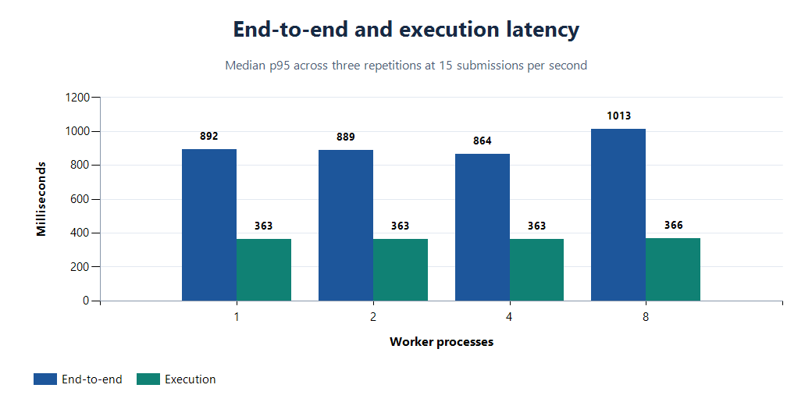

# Native mixed-workload worker scaling — 2026-11-20

JobFlow completed all **5,410** accepted jobs across **12 measured runs**. PostgreSQL reported zero terminal failures, cancellations, remaining jobs, duplicate committed effects, and missing completed-job effects after drain. 225 jobs finished after the measured windows and are excluded from in-window throughput.

## Environment

- Run ID `2026-11-20T08-56-57-045Z-6dc7a537`. Start `2026-11-20T08:56:57.050Z`. Clean source commit `fd07243022952964c3d20055df66778754c9a8ef`.
- Reserved Windows host 10.0.26300 (x64). 11th Gen Intel(R) Core(TM) i3-1115G4 @ 3.00GHz, 4 logical CPUs, 7.75 GiB RAM. All clients and native services shared the host and used loopback. Eight worker processes oversubscribed the four logical CPUs.
- Node v26.13.0, PostgreSQL 17.12, RabbitMQ 4.3.8, Prometheus 3.16.0, and k6.exe v2.4.0 (commit/dd9395906d, go1.26.11, windows/amd64).
- Fixed open-loop workload of 15 submissions/s and 30 preallocated k6 virtual users. Rotated evenly across report generation, simulated email, and the mock webhook. Each repetition had a 15-second warmup and a 30-second arrival window with distinct idempotency keys. Worker prefetch was 10.

## Measured results

The throughput column reports the median and range across three runs. Each latency column reports the median of three run-level p95s in milliseconds. The final ratio divides median throughput by the one-worker median.
The throughput denominator is elapsed wall time from k6 process launch through exit. The database supplies unique completion counts inside that interval and nearest-rank execution and end-to-end percentiles for the settled cohort.

| Workers | Completed jobs/s (range) | HTTP submit p95 (ms) | Execution p95 (ms) | End-to-end p95 (ms) | Throughput ratio |
| ------: | -----------------------: | -------------------: | -----------------: | ------------------: | ---------------: |
|       1 |      14.54 (12.25–14.60) |                 40.4 |                363 |                 892 |           1.000× |
|       2 |      14.47 (10.95–14.54) |                 39.8 |                363 |                 889 |           0.995× |
|       4 |      14.58 (14.56–14.69) |                 39.9 |                363 |                 864 |           1.003× |
|       8 |      14.40 (13.46–14.52) |                 42.6 |                366 |                1013 |           0.990× |

| Workers | Highest sampled worker CPU (cores) | Highest sampled worker RSS (MiB) | Highest sampled nonterminal jobs | Highest sampled outbox lag (s) |
| ------: | ---------------------------------: | -------------------------------: | -------------------------------: | -----------------------------: |
|       1 |                               0.12 |                            169.5 |                               50 |                           3.15 |
|       2 |                               0.16 |                            285.6 |                              128 |                           8.12 |
|       4 |                               0.19 |                            581.4 |                               12 |                           0.53 |
|       8 |                               0.24 |                            901.3 |                               51 |                           3.10 |

Prometheus sampled at 15-second query steps against 2-second scrapes. CPU uses a trailing one-minute rate and RSS sums worker processes. The table reports the highest available complete samples across repetitions. Nonterminal counts include pending, queued, running, and retry-wait jobs in the isolated database. Short-lived spikes between samples can be missed.

## Interpretation and reproduction

At 15 submissions/s, the four-worker configuration had the lowest median end-to-end p95 at 864 ms. Going from one to eight workers increased the highest sampled combined worker RSS from 169.5 to 901.3 MiB while median throughput stayed within 14.40–14.58 completed jobs/s across the matrix. Observed throughput spread was widest at two workers, where the highest sampled outbox lag was 8.12 s. These are observations from three short repetitions per worker count on one host. A separate rate sweep is needed to estimate maximum sustainable throughput. The native broker and database failure tests provide functional recovery evidence independently of this fixed-rate run.

An earlier measurement attempt ended during the transition from two to four workers when Windows rejected replacement of the Prometheus target file. The runner was updated to retry transient file locks. All figures in this report come from the clean, complete rerun.

Run the benchmark from the recorded commit with `BENCHMARK_RUNTIME=native`, `BENCHMARK_RATE=15`, `BENCHMARK_VUS=30`, `BENCHMARK_DURATION=30s`, and `npm run test:load`. Follow the [native setup instructions](../../../docs/METRICS_AND_BENCHMARKS.md#run-on-an-isolated-host) for the database, broker, tenant, API write limit, dispatcher, scheduler, and Prometheus.

The [sanitized per-run data](summary.json) include elapsed windows, k6 admission checks, PostgreSQL reconciliation, p50/p95/p99, and Prometheus sample peaks. Local raw artifacts are in `benchmarks/results/local/2026-11-20T08-56-57-045Z-6dc7a537/`.
