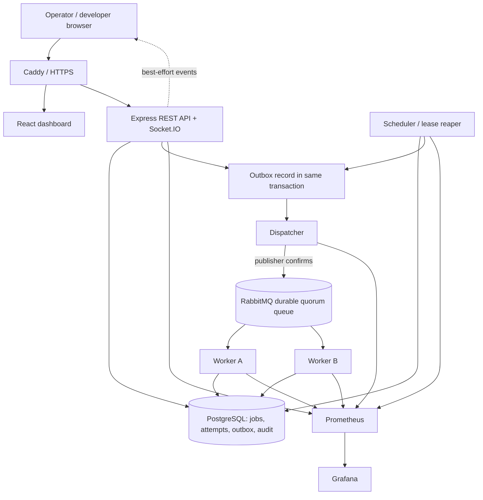
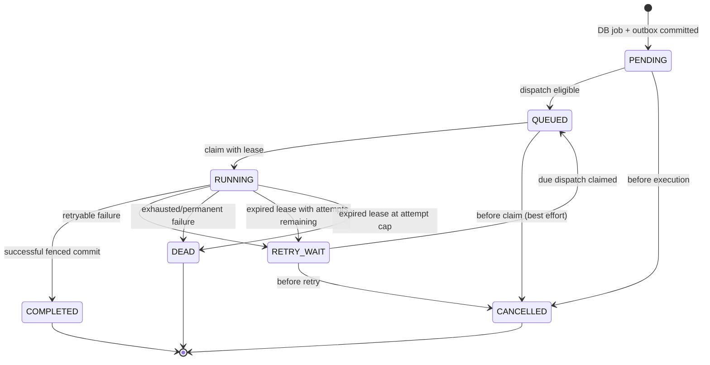

# System Architecture and Correctness Model

## Context

For local Compose, all services run on one host. Multiple workers provide processing concurrency **but not multi-machine availability**.

## Source-of-truth invariant

Each `Job` has one canonical state in PostgreSQL. Broker messages are hints to attempt processing; duplicate/missing/stale messages must be reconciled against Postgres. Outbox makes accepting a job independent of RabbitMQ availability.

Prisma pool connections set the PostgreSQL session time zone to UTC. This keeps UTC timestamps passed through the driver aligned with database scheduling comparisons even on a host with a different time zone.

## Job lifecycle

`QUEUED` means eligible for broker delivery and worker claim, including while RabbitMQ is unavailable. The database and outbox remain authoritative. Each dispatch carries the next attempt number so an older delivery cannot claim a later retry.

## Publish sequence

1. API validates user and payload, calculates stable request hash and idempotency scope.
2. A single DB transaction inserts the `PENDING` job and its first outbox row, with `availableAt = runAt` and unique `(tenantId,idempotencyKey)` when the key is provided.
3. API returns `202 Accepted`, job ID, canonical status. On duplicate key + same payload return original; conflicting payload returns 409.
4. Dispatcher claims a bounded batch of due outbox rows using `FOR UPDATE SKIP LOCKED`. One PostgreSQL statement updates outbox leases, moves eligible jobs to `QUEUED`, and writes the corresponding audit events together before publication. An expired outbox lease allows another dispatcher to reclaim it.
5. After commit, the dispatcher pipelines confirms within one bounded batch of six persistent messages. Each publication correlates mandatory returns to the current publish lease. The dispatcher marks an outbox row `SENT` only after its own routed publish is confirmed and its lease token still matches. Publish failure reschedules the outbox row with backoff. A crash after confirm can result in duplicate delivery.
6. If a later dispatch claim finds that the job was cancelled, already claimed for this attempt, or has advanced beyond it, it retires the obsolete outbox row without changing job state. If cancellation races a publish already in progress, the worker verifies state before acknowledging the stale delivery.

## Worker claim and completion

1. Consume with manual ACK and prefetch (start at 10, tune through benchmark).
2. Atomically transition an eligible `QUEUED` job to `RUNNING` only if the message attempt number equals the stored attempt number plus one and the attempt cap permits it. Set a lease token and expiry, increment the attempt number, and insert the attempt row in the same transaction.
3. If not claimable (already completed/running with active lease), ACK stale message after verifying authoritative state. If DB unavailable, NACK/requeue conservatively with backoff at broker/consumer boundary to avoid hot loops.
4. Execute predefined handler with timeout. While active, heartbeat extends lease using matching token and nonterminal state.
5. Heartbeats and finalization require a `RUNNING` job with a matching, unexpired lease. Commit the result, attempt, audit event, and demo effect record in one transaction.
6. ACK broker message only after durable final state/update. If ACK fails, subsequent delivery is harmless.

The quorum queue uses a length bound and `reject-publish`. A rejected publish leaves the outbox intent available for bounded-backoff retry. The transport delivery limit is disabled so repeated connection loss cannot silently discard the only wake-up for an accepted job. The worker rejects malformed envelopes and delays requeue on database errors. Execution attempts still use the PostgreSQL cap. [RabbitMQ quorum queue configuration](https://www.rabbitmq.com/docs/4.3/quorum-queues)

## Lease and side-effect caveat

Leases can expire while the original worker is still running, especially under pauses/partitions. Fencing tokens prevent stale workers updating the DB, **not** arbitrary external side effects. For actual external sinks, require idempotency token supported by sink or transactional outbox/effect ledger. In demo handlers use DB-upsert with unique `effectKey` to prove no duplicated durable effect.

## Retry sequence

Retryable failure with attempts remaining → finalize the attempt and set `RETRY_WAIT` and `nextRunAt` in one transaction → ACK the previous message. In bounded transactions the scheduler locks due retry rows with `FOR UPDATE SKIP LOCKED` and inserts one unique outbox row per job and next attempt. Exclude jobs with an outbox row for that attempt from subsequent scans. The reaper applies the same retry limit and atomically finalizes the expired attempt. Delay formula:

`next_delay_ms = min(maxDelayMs, baseDelayMs * 2^(attemptNumber - 1) + jitter)`

The scheduler scans in bounded batches every 500 ms when healthy. Job retries start at 500 ms with up to 249 ms of jitter and a 30-second ceiling. The five-attempt submission cap applies across worker crashes and timeout retries. RabbitMQ priorities map to 0, 4, and 8. The live fixture observed high-to-low delivery for queued messages with no work in flight. Multiple consumers and in-flight deliveries bound what can be inferred about overall order.

Do not use unbounded retries. Do not depend on `setTimeout` for durable delays.

## Dead-letter semantics

When retry cap reached, mark job `DEAD`, add durable `dead_letter` entry and audit event. This DB DLQ is authoritative for operator inspection and replay; RabbitMQ native DLX can be configured as an additional broker safety net for rejected/poison messages, **not a substitute** for the business DLQ. Replaying creates a new child job linked to original, with explicit authorization and audit.

## Failure matrix

| Failure | Required observable behavior |
|---|---|
| API crashes after DB commit | Job persists; dispatcher eventually delivers |
| RabbitMQ down when API accepts | Outbox remains pending; dispatch retries with backoff |
| Dispatcher crashes after broker confirms | Duplicate may occur; DB claim blocks double finalization |
| Worker crashes during job | Lease expires; scheduler retries after recovery window |
| Worker completes DB then crashes before ACK | Redelivery sees terminal status, ACKs |
| Worker lease expires but keeps running | Fencing blocks stale DB finalization; effect sink must idempotently guard |
| PostgreSQL down | Do not claim success; backoff and retry; preserve broker deliveries |
| Scheduler down | Due retries and expired leases remain in PostgreSQL and are recovered when scanning resumes |
| Effect succeeds, then a worker loses its lease | The demo effect and result use one fenced transaction. An external sink would need durable idempotency across retries |
| Socket.IO disconnect | UI re-fetches from REST, no lost authoritative state |
| Single EC2 dies | Entire stack is unavailable until recovery. If restoring PostgreSQL with a fresh broker, rearm confirmed dispatches for unclaimed queued jobs before starting services. [Recovery runbook](AWS_DEPLOYMENT.md#recover-when-rebuilding-rabbitmq) |

## Tradeoffs

- Why not only Redis queue? RabbitMQ gives explicit ACKs/publisher confirms, while Postgres records durable business state.
- Why not Kafka? Single-work-item ACK+retry patterns fit RabbitMQ better for this portfolio; Kafka is valid but adds overhead.
- Why not separate microservices on AWS? One-host Docker avoids high cost; modular processes permit later migration.
- Why no strict priority guarantee? Queue ordering, in-flight work, and multiple workers cause approximations. State and test observed behavior.
